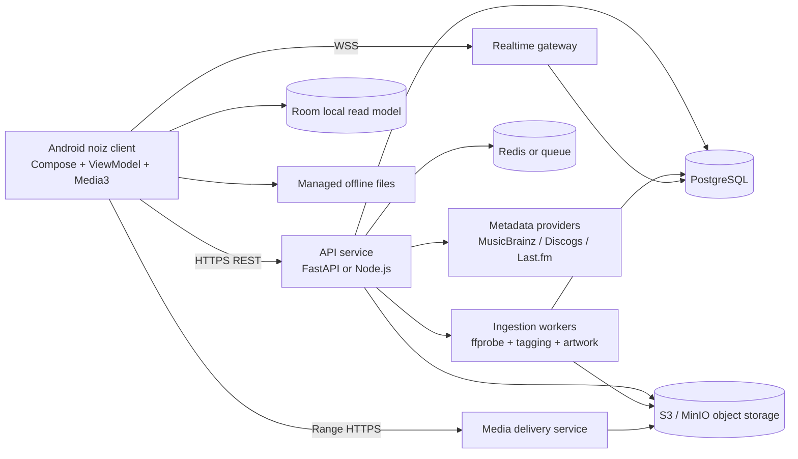

# noiz — Product Requirements Document

**Document status:** Product and architecture baseline  
**Version:** 1.0  
**Author:** Manus AI  
**Target platform:** Android 10+; optimized for Android 12–15  
**Primary audience:** Product owner, Android engineers, backend engineers, designers, QA, and infrastructure operators

## 1. Executive Summary

**noiz** is a self-hosted, private music streaming and discovery application for Android. It provides a premium listening experience without advertising or subscription gates while keeping the catalog, metadata, playback services, and media files under the operator’s control. The application is designed for one owner or a small, explicitly authorized private group. It must not assume that users have permission to copy or redistribute music; the ingestion experience must support only content that the operator owns or is licensed to use.

The recommended product shape is a Kotlin and Jetpack Compose Android client backed by a versioned REST and WebSocket API. The backend owns catalog ingestion, metadata normalization, recommendation computation, authentication, authorization, transcoding policy, and media delivery. The Android application owns responsive playback, local persistence, offline downloads, presentation, Android system integration, and resilient synchronization.

The product should feel like a polished premium streaming client, but it must remain transparent about its self-hosted boundaries. A server administrator can control storage, metadata providers, quality profiles, user access, and recommendation privacy. A listener can browse a library, search the catalog, play lossless audio, build playlists, download content, view synchronized lyrics, scrobble listening activity, and control compatible remote playback targets.

### 1.1 Product goals

1. Deliver reliable, bit-perfect playback when the source file and device path support it.
2. Make a private music library feel discoverable through radio, mixes, mood feeds, and contextual recommendations.
3. Provide first-class offline playback that remains useful when the server or network is unavailable.
4. Integrate correctly with Android system surfaces, including the lock screen, notification shade, Bluetooth controls, Android Auto, audio focus, and headset events.
5. Use an expressive glassmorphism visual system without allowing blur, animation, or album-art processing to damage scrolling or playback performance.
6. Keep ownership and operational boundaries clear: the server stores the canonical library, while the phone maintains a deliberately bounded local replica.

### 1.2 Non-goals for the first release

The initial release will not provide public social feeds, open federation, a public upload marketplace, user-generated public profiles, arbitrary third-party catalog mirroring, or a hosted subscription service. It will not promise digital rights management, watermarking, or legal clearance for uploaded content. It will not support every desktop-class audio workstation function, such as stem separation, editing, or mastering.

## 2. Success Criteria and Product Principles

### 2.1 Success criteria

| Area | Launch target | Measurement method |
|---|---:|---|
| Playback start | 95th percentile under 2.5 seconds on a warm cache and 4G/Wi-Fi | Client playback telemetry |
| Playback reliability | Fewer than 1 unintentional rebuffer per 60 minutes on a healthy network | Session telemetry |
| Offline reliability | 99% of completed downloads playable without network access | Automated device tests and field reports |
| UI performance | 60 frames per second on target mid-range devices for ordinary navigation; no sustained main-thread work above 16 ms per frame | Macrobenchmark and frame timing |
| Catalog search | 95th percentile response below 400 ms for indexed queries | Backend metrics |
| Sync convergence | Client reflects server changes within 60 seconds under normal connectivity | Sync integration tests |
| Crash-free users | At least 99.5% crash-free monthly active users at beta launch | Crash reporting |
| Data integrity | Zero silent catalog or playlist mutations caused by sync conflicts | Conflict test suite and audit log |

### 2.2 Product principles

**Private by default.** A new installation has no public profile and sends no listening history to an external provider unless the user enables scrobbling.

**The server is canonical.** The Android database is a local read model and work queue. It must never silently overwrite server data because a stale screen was edited.

**Playback is a foreground user experience.** Audio playback should continue when the UI is not visible, but it must be represented by a properly configured media session and foreground service when required by the operating system.

**Graceful degradation is a feature.** Missing artwork, unavailable lyrics, unsupported effects, a disconnected server, and an expired metadata provider must each degrade to a useful state rather than block playback.

**Quality is explicit.** The player must show whether it is using the original source, a server-transcoded rendition, or a downloaded copy. It must never label a lossy transcode as lossless.

## 3. Users, Roles, and Primary Journeys

### 3.1 Roles

The system has two logical roles:

| Role | Capabilities |
|---|---|
| Server administrator | Configure storage, scan/import sources, manage metadata providers, create users, set quality policies, inspect jobs, revoke sessions, and manage backups |
| Listener | Browse, search, play, queue, favorite, playlist, download, view lyrics, scrobble, and control authorized devices |

A single-person deployment may use one account with both roles. Authorization must still be enforced server-side so that future private-group deployments do not require a security redesign.

### 3.2 Primary user journeys

**First connection.** The user installs noiz, enters a server URL or scans a pairing QR code, verifies the server certificate or trusted connection, signs in, chooses a default streaming quality, and waits for an initial catalog sync. A small library must become playable before the full artwork and recommendation index finishes downloading.

**Play an album.** The user opens Home or Search, selects an album, and presses play. The client resolves the album into a queue, requests a playback session, prepares Media3, updates the MediaSession, and records an idempotent play-start event. If the network fails, it attempts the local download before showing an error.

**Upload personal music.** The user invokes the Android document picker, chooses one or more supported files, reviews the files and destination, and starts an upload. The client computes checksums, uploads resumable chunks, displays progress, and allows the user to leave the screen. The backend scans, fingerprints, tags, extracts artwork, generates waveforms if enabled, and publishes the track only after validation.

**Download for offline use.** The user selects a track, album, or playlist and chooses a quality profile. WorkManager enqueues a constrained, resumable download. The library shows byte and item progress. A completed item is atomically moved into the managed files directory and indexed in Room.

**Recover from server outage.** The client enters offline mode after a bounded connectivity failure. It exposes downloaded tracks, playlists, local search, queue management, and playback. Write operations are queued locally when safe. The client retries synchronization with exponential backoff and reports conflicts instead of silently discarding edits.

## 4. System Architecture

### 4.1 High-level architecture



The reference deployment consists of an API service, a worker service, a PostgreSQL database, object storage, and an optional Redis-compatible queue. A reverse proxy terminates TLS and forwards API, WebSocket, and byte-range media requests. The deployment may be collapsed into one host for personal use, but service boundaries should remain visible in configuration and code.

### 4.2 Recommended technology choices

| Layer | Recommendation | Rationale |
|---|---|---|
| Android language | Kotlin | Null safety, structured concurrency, and first-class Android tooling |
| UI | Jetpack Compose with Material 3 foundations | Declarative state-driven UI and composable design system |
| State | ViewModel, StateFlow, and immutable UI state | Lifecycle-aware state and testable presentation logic |
| Playback | AndroidX Media3 ExoPlayer | Modern media session, notification, audio focus, caching, and streaming APIs |
| Persistence | Room over SQLite | Typed queries, migrations, observable Flow queries, and offline read model |
| Networking | Retrofit or Ktor client with OkHttp | HTTP caching, interceptors, TLS configuration, and streaming support |
| Background work | WorkManager | Doze-aware retries, network constraints, and durable upload/download jobs |
| Images | Coil | Compose integration, memory/disk caching, and palette extraction pipeline |
| Serialization | Kotlinx Serialization | Explicit wire models and predictable schema evolution |
| Backend | FastAPI or Node.js with PostgreSQL | Both support typed APIs, WebSockets, workers, and mature media tooling |
| Storage | S3-compatible storage such as MinIO | Range reads, lifecycle rules, and self-hosted deployment |
| Observability | OpenTelemetry-compatible traces, structured logs, and metrics | Diagnosis without inspecting personal audio content |

### 4.3 Trust boundaries and security

The Android client must treat the backend as the authority for access decisions. The client must not embed administrator credentials, storage credentials, metadata-provider secrets, or signing keys. Media URLs should be short-lived signed URLs or authenticated range endpoints. The backend must validate object keys and never construct filesystem paths directly from user-provided names.

All production traffic must use HTTPS. A private deployment may use a local certificate authority, but the pairing flow must make trust explicit. Certificate pinning is optional and should be used only if the operator has a rotation plan; a pin that cannot be rotated can strand an installation.

Passwords must be hashed with a memory-hard password hashing scheme such as Argon2id. Access tokens should be short-lived, with refresh-token rotation and server-side revocation. Refresh tokens must be stored in Android Keystore-backed encrypted storage. The server must support per-device sessions, logout, session revocation, and rate limiting for authentication and upload endpoints.

## 5. Catalog, Ingestion, and Discovery

### 5.1 Canonical catalog model

The catalog represents a normalized work rather than a raw file. A track may have multiple source files and derived renditions. Albums and artists are deduplicated by stable external identifiers when available and by normalized fallback keys when not. The original file checksum is retained so that rescans are idempotent.

The backend ingestion state machine is:

```text
DISCOVERED -> HASHED -> PARSED -> MATCHED -> ENRICHED -> DERIVED -> PUBLISHED
                         |          |           |
                         v          v           v
                       REJECTED   NEEDS_REVIEW  PARTIAL
```

A failed enrichment provider must not prevent a valid local file from being published. `NEEDS_REVIEW` is used when multiple metadata matches are plausible or when a parser finds contradictory tags. The administrator can accept, merge, split, or ignore the candidate.

### 5.2 Supported acquisition paths

**Android upload.** Use `ACTION_OPEN_DOCUMENT` with `EXTRA_ALLOW_MULTIPLE` and persist URI permissions only for the duration needed to copy the content into an upload work item. Supported initial formats should include FLAC, ALAC where server decoding is available, MP3, AAC/M4A, Ogg Vorbis, and Opus. The server must inspect the content rather than trust the filename extension.

**Server-side library scan.** A configured import root is scanned by a worker. Files are identified by content checksum and media fingerprint. The scan must not follow symlinks outside approved roots. A library rescan should be incremental and cancellable.

**Archive import.** An operator may import a prepared archive through a server-side path or controlled upload. The system must enforce archive expansion limits, reject path traversal, and report unsupported entries individually.

Noiz must not ship an undisclosed scraping mechanism for copyrighted sources. Any automated importer must use sources and credentials that the operator is authorized to use and must present a clear audit trail.

### 5.3 Metadata enrichment

The server first trusts embedded tags for local identity, then queries configured providers such as MusicBrainz, Discogs, or Last.fm. External identifiers, provider timestamps, and confidence scores must be stored. Provider rate limits must be respected with a queue and cache. The UI should show an administrator when metadata came from a provider and allow reverting to embedded values.

Artwork is normalized into a bounded set of sizes, such as 256, 512, and 1,200 pixels, with a content hash. The backend should preserve the original artwork separately when permitted. Client artwork URLs must be cacheable and immutable by content hash.

### 5.4 Discovery engine

Discovery is a server-side feature that produces explainable candidate lists. The initial engine should use deterministic signals before introducing a machine-learning model:

- Recent plays and completion rate.
- Favorites and explicit skips.
- Artist, album, genre, decade, mood, and tempo tags.
- Co-occurrence in playlists and albums.
- Time-of-day and session context, only when locally or server-side configured.
- Novelty and diversity constraints to avoid returning the same artist repeatedly.

Each recommendation response should include a reason code such as `because_you_liked_artist`, `from_your_library`, or `similar_genre`. A candidate that is not available in the private catalog must not be presented as playable. “Made for You” is therefore a set of private-library mixes, not an external catalog promise.

## 6. Functional Requirements

### 6.1 Playback

The player must support play, pause, seek, previous, next, repeat-off, repeat-one, repeat-all, shuffle, queue editing, and resume position. Queue mutations must be modeled as commands with a monotonically increasing client sequence so that a reconnect does not reorder commands unpredictably.

Gapless playback should use Media3 playlist preparation and compatible decoder behavior. Crossfade from 1 to 12 seconds is a preference applied only when both adjacent items are compatible and the device has sufficient headroom. A crossfade is not a substitute for true gapless playback and must be disabled for spoken-word content when detected or configured.

Loudness normalization should be based on stored track or album loudness metadata. The server may calculate ReplayGain-like values during ingestion. The client should apply a gain adjustment within a safe range and expose a preamp setting. It must not clip audio because normalization is enabled.

The equalizer should be an optional effect attached to the active audio session. The initial implementation should expose a small set of tested presets and a parametric band editor only on devices whose audio effects API behaves correctly. The client must detect unavailable or vendor-broken effects and fall back to unprocessed playback. The UI must not imply that an effect is active when the platform rejected it.

### 6.2 Audio quality and delivery

The server must preserve the original source and advertise its properties. A quality profile includes codec, sample rate, bit depth, channel count, and maximum bandwidth. The initial profiles are:

| Profile | Intended use | Delivery |
|---|---|---|
| Original lossless | Wi-Fi, local network, or explicit user choice | Original FLAC/ALAC where supported, using byte ranges |
| High quality | Mobile default for capable connections | Server-derived AAC or Opus rendition, configured bitrate |
| Data saver | Metered or poor networks | Lower bitrate AAC/Opus rendition |
| Offline lossless | Explicit download choice | Original or lossless derived file |

The server must not transcode unnecessarily. Direct byte-range delivery is the default for complete file playback because it is simple, cache-friendly, and suitable for VBR files when the client can seek by byte or uses known duration metadata. HLS is recommended when the deployment needs adaptive bitrate switching, tokenized segment access, or a unified live/recorded pipeline. The first release should implement direct range streaming and leave HLS behind a versioned capability flag.

A range request must support `Accept-Ranges: bytes`, correct `Content-Range`, `206 Partial Content`, stable `ETag`, and `If-Range`. The server must reject invalid ranges safely and avoid loading an entire large file into memory.

### 6.3 Offline mode

Downloads are explicit user actions. Each download stores a server track ID, content hash, quality profile, encryption or protection state, local path, byte count, checksum, and completion state. The client must write to a temporary file, verify the checksum, fsync or safely close the file, and atomically rename it into the managed media directory.

The product should support optional application-layer encryption for offline files using a randomly generated file key wrapped by an Android Keystore key. This protects against casual file browsing but is not DRM. The UI must describe it accurately. If encryption is enabled, playback must stream through a decrypting data source without creating an unencrypted copy.

Offline search must use Room metadata and remain functional without network access. Offline queue playback must skip unavailable files with a clear explanation and continue to the next playable item. The client must not delete a user’s downloaded files merely because a server catalog item temporarily disappeared; it should mark the item orphaned and offer cleanup.

### 6.4 Lyrics and visuals

Lyrics are optional metadata. The backend should store synchronized LRC lines and an attribution/provider field. LRCLIB or another configured provider may be used only when permitted by its terms and when the operator has enabled it. Unsynchronized lyrics should be displayed as static text and clearly labeled.

The lyrics renderer must map player position to the active line using a binary search over timestamped lines. It should scroll the active line into view without forcing a full-screen recomposition. Manual offset adjustment must be available for misaligned files.

Looped background videos are an optional enhancement. They must be muted, bounded in resolution, paused when the screen is not visible, and disabled under battery saver or when the user chooses reduced motion. A static gradient or artwork fallback is mandatory.

### 6.5 Uploads and jobs

Uploads must be resumable and idempotent. The client should use a server-created upload session with a content checksum and chunk size. Each chunk is acknowledged independently. A retry must not duplicate a chunk. The server finalizes only after all chunks are present and the final checksum matches.

The upload screen must show file name, size, current phase, retry state, and a cancel action. Cancellation is reversible until the server garbage-collects the incomplete session. A failed parse must preserve an actionable error and must not publish a partial track.

### 6.6 Playlists, favorites, and history

Playlists support ordered tracks, names, descriptions, artwork selection, and collaborative editing only when explicitly enabled by the administrator. Favorites are a user-track relation and must be idempotent. History records play starts, meaningful progress, completion, skip, and source device.

A play should count as meaningful after a configurable threshold, such as 30 seconds or 50% of a short track. Events must carry a client-generated idempotency key. The server may deduplicate late-arriving events by that key.

### 6.7 Remote playback and scrobbling

Remote control is implemented through server-mediated playback sessions. A controller sends commands to a target device. The target owns the actual audio session and periodically publishes position, duration, item ID, and state. Commands include a command ID and expected revision. A stale controller receives the current revision rather than overwriting it.

ListenBrainz and Last.fm scrobbling must be opt-in, separately configurable, and revocable. Tokens belong on the backend when practical, with an encrypted client fallback only if required. Scrobbles must be queued and retried. The user must be able to delete locally queued scrobble events before transmission.

## 7. UX and Glassmorphism Design System

### 7.1 Information architecture

The bottom navigation contains **Home**, **Search**, and **Library**. The mini-player is persistent above navigation when an item is active. Tapping it expands a full-screen Now Playing surface. Settings and server status are available from the profile or overflow entry.

Home contains a recently played rail, continue listening, private-library mixes, new additions, and contextual recommendations. Search begins with a focused text field and offers recent searches, genres, moods, artists, albums, tracks, playlists, and server-side filters. Library contains playlists, albums, artists, downloads, favorites, and local-only content.

### 7.2 Visual tokens

The design system uses semantic tokens rather than hard-coded colors:

| Token | Light intent | Dark intent |
|---|---|---|
| `surfaceGlass` | White with approximately 60–75% opacity | Near-black with approximately 45–65% opacity |
| `surfaceElevated` | White with stronger opacity | Dark neutral with stronger opacity |
| `borderGlass` | White or neutral at low alpha | White at low alpha |
| `contentPrimary` | High-contrast neutral | Near-white |
| `contentSecondary` | Muted neutral | Muted cool neutral |
| `accentDynamic` | Extracted accent with contrast correction | Extracted accent with luminance clamp |

The actual alpha values must be tuned with screenshot tests and accessibility checks. Glass is a material treatment, not a reason to lower contrast. Text and essential controls must meet accessible contrast targets against the composited surface.

### 7.3 Efficient blur implementation

Android 12+ `RenderEffect` can provide platform blur, but applying a unique blur effect to every scrolling card is too expensive. The implementation must follow these rules:

1. Use one blurred backdrop layer per major surface, not one blur node per child.
2. Render album-art color and a low-resolution artwork backdrop into a dedicated background composable.
3. Apply `RenderEffect.createBlurEffect` only to that bounded backdrop when the device and API level support it.
4. Clip blur bounds to the visible surface and avoid full-screen blur during rapid scroll.
5. During active scrolling, replace expensive blur with a cached blurred bitmap or a translucent color wash. Restore live blur after scroll settles.
6. Cache palette extraction by artwork content hash and perform extraction off the main thread.
7. Avoid changing the blur radius every frame. Animate opacity or a precomputed layer instead.
8. Use `Modifier.graphicsLayer` for alpha, scale, and translation transforms so Compose can reuse the layer.
9. Provide a reduced-motion and reduced-transparency setting.
10. Verify frame timing on representative low-, mid-, and high-tier devices with Macrobenchmark.

On devices below Android 12, use a cached blurred bitmap, a gradient scrim, or a translucent surface. The fallback must preserve hierarchy and readability rather than attempting an unbounded software blur.

### 7.4 Motion and gestures

The mini-player expands into Now Playing using a shared transition with a stable track identity. The transition must be interruptible and must not restart playback. Swipe-to-queue gestures must have an accessible button equivalent and a visible confirmation state. Physics-based scrolling should use conservative spring values; overscroll must not move important controls outside reach.

Every animation must define a reduced-motion behavior. Lyrics line changes may use a short fade or no animation. Queue reordering must announce the new position through accessibility semantics.

## 8. Android Client Architecture

### 8.1 Module structure

```text
:app
:core:common
:core:model
:core:network
:core:database
:core:datastore
:core:designsystem
:core:media
:core:sync
:feature:home
:feature:search
:feature:library
:feature:nowplaying
:feature:lyrics
:feature:downloads
:feature:settings
```

Each feature exposes UI and ViewModel code but depends on domain interfaces rather than concrete network clients. Repository implementations combine Room, network, and sync queues. The media module owns MediaSession, playback service, queue mapping, audio focus, and player analytics.

### 8.2 State model

Screen state should be immutable and derived from repositories. A typical screen exposes `StateFlow<UiState>`, while one-shot effects such as snackbars use a channel or effect flow. ViewModels must not own a long-lived player instance; the playback service and a media controller provide the boundary.

```kotlin
data class NowPlayingUiState(
    val item: Track? = null,
    val isPlaying: Boolean = false,
    val positionMs: Long = 0,
    val durationMs: Long = 0,
    val bufferedMs: Long = 0,
    val repeatMode: RepeatMode = RepeatMode.OFF,
    val shuffleEnabled: Boolean = false,
    val quality: PlaybackQuality = PlaybackQuality.UNKNOWN,
    val error: PlaybackError? = null
)
```

### 8.3 Media service behavior

Use a `MediaLibraryService` or equivalent Media3 service so external clients can browse and control the catalog. The service must expose a stable media ID hierarchy for root, playlists, albums, artists, and downloads. MediaSession callbacks must delegate to a single player coordinator to prevent divergent state between the notification, app UI, Android Auto, and Bluetooth controls.

The service must run as a foreground service while actively playing when required by the target Android version. Its notification must contain media controls, artwork, playback state, and a route to the Now Playing screen. It must stop itself after playback ends and the configured idle timeout elapses.

## 9. Data Models

### 9.1 Backend relational schema

The following PostgreSQL-style schema is a logical baseline. Production migrations may normalize or partition further.

```sql
CREATE TABLE users (
  id UUID PRIMARY KEY,
  username TEXT UNIQUE NOT NULL,
  password_hash TEXT NOT NULL,
  role TEXT NOT NULL CHECK (role IN ('admin', 'listener')),
  created_at TIMESTAMPTZ NOT NULL,
  updated_at TIMESTAMPTZ NOT NULL
);

CREATE TABLE artists (
  id UUID PRIMARY KEY,
  name TEXT NOT NULL,
  sort_name TEXT NOT NULL,
  normalized_name TEXT NOT NULL,
  musicbrainz_id TEXT,
  metadata JSONB NOT NULL DEFAULT '{}',
  created_at TIMESTAMPTZ NOT NULL,
  updated_at TIMESTAMPTZ NOT NULL
);

CREATE TABLE albums (
  id UUID PRIMARY KEY,
  title TEXT NOT NULL,
  sort_title TEXT NOT NULL,
  artist_id UUID REFERENCES artists(id),
  year SMALLINT,
  artwork_hash TEXT,
  metadata JSONB NOT NULL DEFAULT '{}',
  created_at TIMESTAMPTZ NOT NULL,
  updated_at TIMESTAMPTZ NOT NULL
);

CREATE TABLE tracks (
  id UUID PRIMARY KEY,
  album_id UUID REFERENCES albums(id),
  artist_id UUID REFERENCES artists(id),
  title TEXT NOT NULL,
  disc_number SMALLINT NOT NULL DEFAULT 1,
  track_number SMALLINT,
  duration_ms BIGINT NOT NULL,
  codec TEXT NOT NULL,
  sample_rate INTEGER,
  bit_depth SMALLINT,
  channels SMALLINT,
  loudness_lufs REAL,
  fingerprint TEXT,
  metadata JSONB NOT NULL DEFAULT '{}',
  availability TEXT NOT NULL DEFAULT 'published',
  created_at TIMESTAMPTZ NOT NULL,
  updated_at TIMESTAMPTZ NOT NULL
);

CREATE TABLE media_assets (
  id UUID PRIMARY KEY,
  track_id UUID NOT NULL REFERENCES tracks(id) ON DELETE CASCADE,
  kind TEXT NOT NULL CHECK (kind IN ('original', 'rendition', 'artwork', 'video')),
  codec TEXT,
  object_key TEXT NOT NULL,
  content_hash TEXT NOT NULL,
  size_bytes BIGINT NOT NULL,
  sample_rate INTEGER,
  bit_depth SMALLINT,
  bitrate INTEGER,
  created_at TIMESTAMPTZ NOT NULL,
  UNIQUE(track_id, kind, content_hash)
);

CREATE TABLE playlists (
  id UUID PRIMARY KEY,
  owner_id UUID NOT NULL REFERENCES users(id),
  name TEXT NOT NULL,
  description TEXT,
  revision BIGINT NOT NULL DEFAULT 0,
  created_at TIMESTAMPTZ NOT NULL,
  updated_at TIMESTAMPTZ NOT NULL
);

CREATE TABLE playlist_tracks (
  playlist_id UUID REFERENCES playlists(id) ON DELETE CASCADE,
  track_id UUID REFERENCES tracks(id),
  position NUMERIC NOT NULL,
  added_by UUID REFERENCES users(id),
  added_at TIMESTAMPTZ NOT NULL,
  PRIMARY KEY (playlist_id, track_id)
);

CREATE TABLE favorites (
  user_id UUID REFERENCES users(id) ON DELETE CASCADE,
  track_id UUID REFERENCES tracks(id) ON DELETE CASCADE,
  created_at TIMESTAMPTZ NOT NULL,
  PRIMARY KEY (user_id, track_id)
);

CREATE TABLE play_history (
  id UUID PRIMARY KEY,
  user_id UUID REFERENCES users(id),
  track_id UUID REFERENCES tracks(id),
  device_id TEXT NOT NULL,
  event_type TEXT NOT NULL,
  position_ms BIGINT,
  occurred_at TIMESTAMPTZ NOT NULL,
  idempotency_key TEXT UNIQUE NOT NULL
);
```

Indexes must cover normalized search fields, artist and album relations, playlist ownership, history by user and time, and content hashes. Full-text search should use PostgreSQL search or a dedicated search index only after measuring catalog size.

### 9.2 Room entities

Room should store a compact read model rather than mirror every backend column. Each entity includes `serverUpdatedAt`, `syncState`, and, where needed, a tombstone. Media files are represented separately from metadata so a catalog refresh cannot invalidate a completed download.

```kotlin
@Entity(tableName = "tracks", indices = [Index("normalizedTitle"), Index("albumId")])
data class TrackEntity(
    @PrimaryKey val id: String,
    val title: String,
    val normalizedTitle: String,
    val albumId: String?,
    val artistId: String?,
    val durationMs: Long,
    val artworkHash: String?,
    val availability: String,
    val serverUpdatedAt: Instant
)

@Entity(tableName = "download_items", indices = [Index(value = ["trackId"], unique = true)])
data class DownloadItemEntity(
    @PrimaryKey val trackId: String,
    val profile: String,
    val path: String?,
    val expectedHash: String,
    val bytesDownloaded: Long,
    val totalBytes: Long?,
    val state: String,
    val lastError: String?
)
```

## 10. API Contract

All API responses include a request ID. Errors use a stable machine-readable code, a human-readable message, and optional field details. API versioning uses `/api/v1`. The backend must preserve backward compatibility within a major version.

### 10.1 Authentication and catalog routes

| Method | Route | Purpose |
|---|---|---|
| `POST` | `/api/v1/auth/login` | Exchange credentials for access and refresh tokens |
| `POST` | `/api/v1/auth/refresh` | Rotate a refresh token |
| `POST` | `/api/v1/auth/logout` | Revoke the current session |
| `GET` | `/api/v1/me` | Return user, server capabilities, and policy |
| `GET` | `/api/v1/catalog/sync?cursor=...` | Pull catalog changes and a next cursor |
| `GET` | `/api/v1/search?q=...&type=...` | Search tracks, albums, artists, and playlists |
| `GET` | `/api/v1/tracks/{trackId}` | Fetch track metadata and playable assets |
| `GET` | `/api/v1/albums/{albumId}` | Fetch album details and ordered tracks |
| `GET` | `/api/v1/recommendations/home` | Return explainable home sections |
| `GET` | `/api/v1/lyrics/{trackId}` | Return lyrics and synchronization metadata |

Example track response:

```json
{
  "id": "track_01J...",
  "title": "Example Track",
  "durationMs": 241000,
  "album": {"id": "album_01J...", "title": "Example Album"},
  "artists": [{"id": "artist_01J...", "name": "Example Artist"}],
  "artwork": {"hash": "sha256:...", "url": "/api/v1/artwork/sha256:..."},
  "assets": [
    {
      "id": "asset_01J...",
      "kind": "original",
      "codec": "flac",
      "sampleRate": 96000,
      "bitDepth": 24,
      "sizeBytes": 81234567,
      "streamUrl": "/api/v1/media/asset_01J..."
    }
  ]
}
```

### 10.2 Playback and history routes

| Method | Route | Purpose |
|---|---|---|
| `POST` | `/api/v1/playback/sessions` | Create a playback session and resolve a queue |
| `GET` | `/api/v1/playback/sessions/{id}` | Read current remote-playback state |
| `POST` | `/api/v1/playback/sessions/{id}/commands` | Send play, pause, seek, next, or queue command |
| `POST` | `/api/v1/history/events` | Submit idempotent play and progress events |
| `GET` | `/api/v1/history` | Read user history |
| `PUT` | `/api/v1/favorites/{trackId}` | Add a favorite |
| `DELETE` | `/api/v1/favorites/{trackId}` | Remove a favorite |

### 10.3 Upload and download routes

| Method | Route | Purpose |
|---|---|---|
| `POST` | `/api/v1/uploads` | Create an upload session |
| `PUT` | `/api/v1/uploads/{id}/parts/{partNumber}` | Upload one resumable part |
| `POST` | `/api/v1/uploads/{id}/complete` | Finalize and checksum an upload |
| `DELETE` | `/api/v1/uploads/{id}` | Cancel an incomplete upload |
| `GET` | `/api/v1/media/{assetId}` | Authenticated range stream |
| `GET` | `/api/v1/downloads/manifest` | Return download hashes and policy |

### 10.4 WebSocket events

Connect to `/api/v1/ws` with an access token and subscribe to topics. The server sends a heartbeat and closes idle connections after a bounded timeout. The client reconnects with jitter and resubscribes.

```json
{"type":"playback.state","revision":42,"sessionId":"sess_01J...","state":{"trackId":"track_01J...","isPlaying":true,"positionMs":18342}}
{"type":"catalog.changed","cursor":"cur_01J...","entities":["track:track_01J...","album:album_01J..."]}
{"type":"job.progress","jobId":"job_01J...","phase":"tagging","percent":67}
```

## 11. Operational Requirements

### 11.1 Backups and recovery

The operator must back up PostgreSQL, object storage, configuration, and signing secrets separately. A backup is not complete until a restore test can reconstruct the catalog and play at least one asset. Database rows and object keys must be consistent; the ingestion pipeline should support rebuilding derived renditions and artwork from originals when those are not included in a backup.

### 11.2 Observability and privacy

Metrics should include request latency, playback-start latency, range errors, transcode queue depth, upload failures, download failures, sync lag, and WebSocket reconnects. Logs must use opaque IDs and must not record raw filenames, lyrics, access tokens, or full media URLs. Detailed client telemetry is opt-in or minimized to operational events.

### 11.3 Performance budgets

The Android application should keep the base install lean by avoiding bundled media and by using dynamic feature boundaries only when justified. The first screen should render from cached state without waiting for artwork or recommendation calls. Artwork memory use must be bounded by Coil policies. Large queues must be paged or windowed rather than fully composed.

## 12. Edge Cases and Failure Contingencies

### 12.1 Doze mode and background execution

Playback is handled by the Media3 service and foreground notification, not by a background coroutine owned by an Activity. Uploads, catalog sync, and downloads use WorkManager with network and battery constraints. A worker must persist progress after each committed chunk and return `Result.retry()` for transient failures. It must return `Result.failure()` with a user-visible reason for permanent failures.

### 12.2 Audio focus and interruptions

On transient audio focus loss, pause or duck according to the focus type and user preference. On permanent loss, pause and abandon focus. Calls, navigation prompts, alarms, Bluetooth disconnects, and headset removal must each be handled through the Media3 audio focus manager and tested on physical devices. Resumption after a call must not occur if the user manually paused during the interruption.

### 12.3 Network dropouts

Media3 should use a bounded buffer and retry policy. On a range failure, the player retries with backoff, then switches to a lower profile if policy allows. If a downloaded copy is available, it should be selected before presenting an error. The UI should distinguish a stalled connection from an invalid asset and from an authorization failure.

### 12.4 Scoped Storage

Use the Storage Access Framework for user-selected input. Do not request broad storage permissions for ordinary upload. Copy selected content into an app-managed temporary area and delete it after successful upload or cancellation. Use MediaStore only when exporting a user-selected downloaded file to a user-visible location.

### 12.5 Clock skew and event ordering

Server timestamps are canonical for synchronization. Client events include both client time and a monotonic sequence. The server must tolerate clock skew and order events by server receipt plus event sequence where applicable. Remote playback uses revisions rather than wall-clock timestamps alone.

### 12.6 Metadata collisions

When two files map to the same normalized identity, retain separate source assets until an administrator confirms a merge. Never delete a source file because a metadata provider returned a duplicate. A merge creates redirects so existing playlist references remain valid.

### 12.7 Storage exhaustion

Before downloading or importing, the client and server should estimate required space. If storage drops below a safety threshold, pause nonessential downloads and show the largest removable offline items. The server must reject uploads that exceed configured quotas before receiving all bytes where possible.

### 12.8 Unsupported codecs and corrupt files

The ingestion worker must classify unsupported codecs, malformed containers, missing duration, and checksum mismatch separately. The catalog may show a non-playable track to an administrator, but listeners should not see it in playable recommendations. The error must include a remediation path, such as installing a server decoder or replacing the file.

## 13. Accessibility, Localization, and Safety

All interactive controls require content descriptions, minimum touch targets, keyboard or switch access where supported, and a semantics tree that describes playback state. Dynamic color must never be the only way to communicate selection or availability. Lyrics and artwork need alternative text or a meaningful spoken description.

Text must be externalized from the beginning. Track titles and artist names may use scripts that affect sorting and line breaking. The server should provide normalized search fields while preserving display text. Right-to-left layouts, long titles, missing artwork, and pluralized download counts must be covered by UI tests.

A server administrator must be able to disable external metadata, lyrics, scrobbling, remote control, and video features independently. This limits data sharing and reduces the attack surface for a private deployment.

## 14. Testing Strategy and Definition of Done

### 14.1 Test layers

Unit tests cover repository conflict handling, queue commands, lyric timestamp lookup, loudness calculations, range parsing, and recommendation scoring. Room migration tests validate every schema version. API contract tests validate error codes, pagination, cursors, range headers, and idempotency.

Android instrumentation tests cover MediaSession commands, notification actions, process death recovery, offline search, download atomicity, scoped-storage picker flows, accessibility semantics, and configuration changes. Macrobenchmarks cover cold start, library scrolling, Now Playing expansion, artwork transitions, and search typing.

End-to-end tests run a disposable backend with seeded assets. They verify login, initial sync, stream start, upload, ingestion, metadata correction, download, server outage, reconnect, remote command revision handling, and scrobble opt-in behavior.

### 14.2 Definition of done for a feature

A feature is complete when its product acceptance criteria, API contract, Room migration if applicable, analytics or operational signal, accessibility behavior, offline or failure behavior, automated tests, and documentation are present. It must not be marked complete solely because the happy-path UI works.

## 15. Phased Roadmap

### Phase 0 — Foundation and risk reduction

Establish the repository, CI, code quality rules, API versioning, authentication, PostgreSQL migrations, object storage, local development deployment, and seeded test media. Build a vertical slice from server catalog to Android track list to Media3 playback. Resolve TLS pairing, range requests, process death, and device audio focus before adding visual polish.

**Exit criteria:** A test user can sign in, browse a seeded catalog, play a track over a range request, receive lock-screen controls, and recover playback after a configuration change.

### Phase 1 — MVP

Deliver the Compose application shell, Home, Search, Library, album and track detail, basic playlist creation, favorites, Media3 playback, notification controls, manual Android upload, server-side ingestion, artwork extraction, basic metadata enrichment, and initial sync.

**Exit criteria:** A private operator can upload authorized audio from Android, see it in the catalog, search it, play it, favorite it, and build a playlist. The app remains useful with cached catalog data when the server is temporarily unreachable.

### Phase 2 — Parity features

Add resilient downloads, offline search and playback, WorkManager background work, lyrics with LRC rendering, loudness normalization, tested equalizer presets, crossfade, background playback hardening, Android 12+ blur treatment, and server-side quality profiles.

**Exit criteria:** A user can download a playlist, disable connectivity, search and play it, receive correct audio focus behavior, view synced lyrics, and observe a stable 60 fps experience on target devices.

### Phase 3 — Discovery and polish

Add explainable radio and private-library mixes, mood and genre feeds, dynamic palette extraction, shared Now Playing transitions, Android Auto browsing, remote playback sessions, WebSocket state updates, scrobbling integrations, and administrator job monitoring.

**Exit criteria:** Discovery produces relevant, playable, non-repetitive mixes; Android Auto supports safe browse and playback control; remote control converges under reconnects; and the glass system remains accessible and performant.

### Phase 4 — Hardening and optional expansion

Add multi-user private groups, richer conflict resolution, HLS capability for adaptive delivery, server-side waveform or video enhancements, automated backup verification, and a formal plugin model for additional metadata providers. Each addition requires a threat-model review and an explicit privacy setting.

## 16. Release Checklist

Before beta distribution, the team must verify that production secrets are externalized, TLS and token rotation are tested, administrator and listener permissions are separate, range requests are protected, upload paths reject traversal, backups restore successfully, and logs do not expose personal media details.

The Android release must pass tests for Android 10 through the current supported release, at least one low-memory device, metered and unmetered networks, Bluetooth headset connect and disconnect, incoming calls, Doze, process death, rotation or window resizing, dark and light themes, large font scale, reduced motion, and accessibility services.

The product documentation must explain self-hosting, supported codecs, storage requirements, metadata-provider credentials, backup responsibilities, offline-file protection limits, and the operator’s responsibility to use content lawfully.

## 17. Open Decisions to Resolve Before Implementation Lock

1. Whether the first server implementation uses FastAPI or Node.js. The API contract should remain language-neutral.
2. Whether the first release supports only direct range streaming or also ships a server-side HLS rendition pipeline.
3. Whether offline file encryption is enabled by default or offered as a per-server policy.
4. Which metadata and lyrics providers are enabled in the default deployment, based on their current terms and rate limits.
5. Whether remote playback is in Phase 3 for a single user only or is designed immediately for a small private group.
6. The minimum Android API level after device telemetry and required `RenderEffect` behavior are evaluated.

## References

[1]: https://developer.android.com/develop/ui/compose "Jetpack Compose documentation"

[2]: https://developer.android.com/media/media3 "Android Media3 documentation"

[3]: https://developer.android.com/training/data-storage/room "Android Room persistence library documentation"

[4]: https://developer.android.com/topic/libraries/architecture/workmanager "Android WorkManager documentation"

[5]: https://developer.android.com/develop/ui/views/layout/edge-to-edge "Android edge-to-edge guidance"

[6]: https://developer.android.com/reference/android/graphics/RenderEffect "Android RenderEffect reference"

[7]: https://developer.android.com/training/cars/media "Android for Cars media apps guidance"

[8]: https://developer.android.com/training/data-storage/shared/documents-files "Android Storage Access Framework documentation"

[9]: https://developer.android.com/guide/topics/media-apps/audio-focus "Android audio focus documentation"

[10]: https://developer.android.com/training/monitoring-device-state/doze-standby "Android Doze and App Standby documentation"

[11]: https://developer.android.com/training/articles/keystore "Android Keystore system documentation"

[12]: https://developer.android.com/topic/security/best-practices "Android security best practices"

[13]: https://developer.android.com/studio/profile/macrobenchmark "Android Macrobenchmark documentation"

[14]: https://developer.android.com/develop/ui/compose/accessibility "Jetpack Compose accessibility guidance"

[15]: https://developer.android.com/develop/ui/compose/performance "Jetpack Compose performance guidance"

[16]: https://www.rfc-editor.org/rfc/rfc9110.html "HTTP Semantics and range requests"

[17]: https://musicbrainz.org/doc/MusicBrainz_API "MusicBrainz API documentation"

[18]: https://www.last.fm/api "Last.fm API documentation"

[19]: https://listenbrainz.readthedocs.io/en/latest/users/api/ "ListenBrainz API documentation"

[20]: https://min.io/docs/minio/linux/index.html "MinIO documentation"

[21]: https://www.postgresql.org/docs/current/textsearch.html "PostgreSQL full-text search documentation"

[22]: https://owasp.org/www-project-mobile-top-10/ "OWASP Mobile Top 10"
